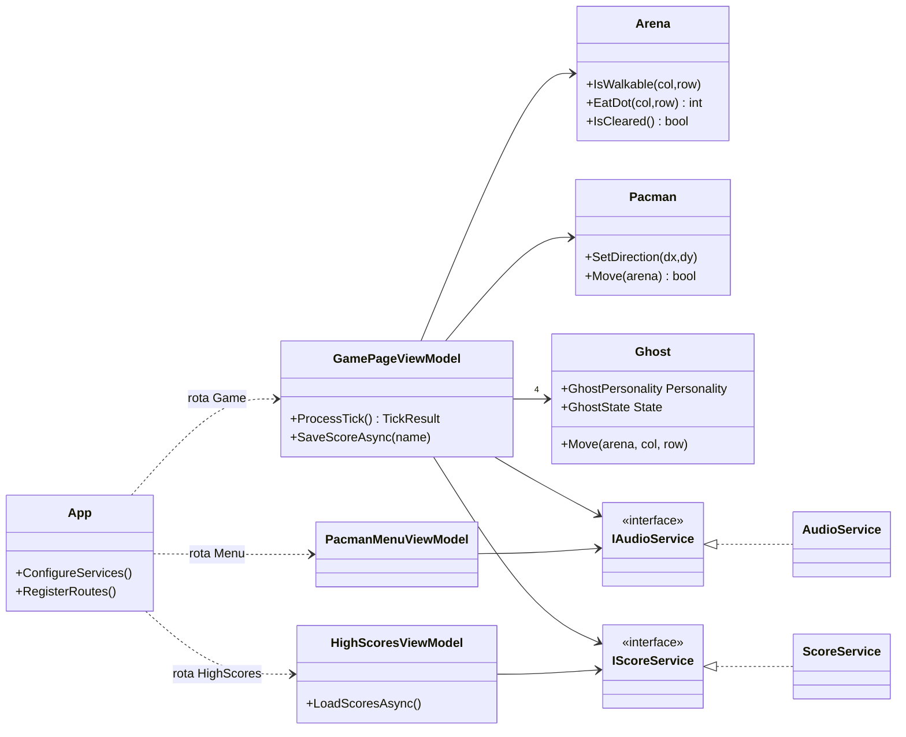

# 🟡 Pac-Man em C# com Uno Platform

> Releitura do arcade clássico em C# / .NET 9: labirinto, quatro fantasmas com comportamentos distintos, power pellets, efeitos sonoros e ranking persistente — tudo em arquitetura MVVM.

<!-- TODO: gravar um GIF da gameplay e salvar em docs/demo.gif -->


## Sobre o projeto

Projeto de estudo desenvolvido em equipe com o objetivo de praticar C#, a Uno Platform e o padrão MVVM construindo um jogo completo: da modelagem das regras ao áudio, à persistência de pontuações e à navegação entre telas.

O planejamento visual das telas está em [TEMPLATES.md](TEMPLATES.md).

## Funcionalidades

- **Menu principal** com as opções Iniciar jogo, Pontuações, Som (liga/desliga) e Sair.
- **Movimento contínuo** com as setas ou `W` `A` `S` `D`, com buffer de direção (a curva é feita assim que o caminho fica livre) e colisão com paredes.
- **Labirinto 28×31** com pontos (10 pts) e 4 power pellets (50 pts).
- **Quatro fantasmas com personalidades próprias:**

  | Fantasma | Alvo durante a perseguição |
  |----------|----------------------------|
  | Blinky (vermelho) | A posição atual do Pac-Man |
  | Pinky (rosa) | 4 células à frente, na direção em que o próprio fantasma se move |
  | Inky (ciano) | O ponto médio entre ele e o Pac-Man |
  | Clyde (laranja) | O Pac-Man quando está longe (distância > 8); o canto inferior esquerdo quando está perto |

- **Modo assustado**: ao comer um power pellet, os fantasmas ficam vulneráveis por 30 ticks (~4,5 s) e piscam quando o efeito está acabando. Fantasma comido vale 200 pts e volta para a casa.
- **3 vidas**, com sprite de morte e reposicionamento de personagens a cada vida perdida.
- **Fim de jogo**: Game Over ao perder todas as vidas ou Vitória ao comer todos os pontos, com diálogo para registrar o nome (até 10 caracteres).
- **Ranking persistente** em JSON, exibindo o top 10 com destaque para os três primeiros.
- **Efeitos sonoros** para início de jogo, comer ponto, power pellet, perder vida, game over, vitória e cliques de interface.
- `ESC` volta ao menu durante a partida.

<!-- TODO: o jogo tem uma única fase — o contador de nível fica em 1 e a vitória retorna ao menu. -->

## Tecnologias

| Tecnologia | Uso |
|------------|-----|
| C# / .NET 9 (`net9.0-desktop`) | Linguagem e runtime |
| Uno Platform 6.4.58 (Uno.Sdk) | UI multiplataforma em XAML (WinUI), renderizador Skia |
| CommunityToolkit.Mvvm | `ObservableObject`, `[ObservableProperty]`, `[RelayCommand]` |
| Uno.Extensions (Hosting, Navigation, Configuration, Logging) | Injeção de dependência, navegação por rotas, configuração e logs |
| Uno Material / Toolkit | Tema e componentes visuais |
| System.Text.Json | Persistência do ranking |
| Windows Media Player (COM) / ffplay · mpg123 | Reprodução de áudio no Windows / Linux |

## Arquitetura

O código segue **MVVM** em três camadas:

- **Models** — regras do jogo puras, sem dependência de UI: labirinto e pontos (`Arena`), movimento do jogador (`Pacman`) e máquina de estados + IA dos fantasmas (`Ghost`).
- **Services** — persistência do ranking (`ScoreService`) e áudio multiplataforma (`AudioService`), expostos por interfaces e registrados na injeção de dependência.
- **Presentation** — ViewModels com estado observável e comandos; a `GamePage` desenha o jogo em um `Canvas` e, a cada tick de 150 ms, chama `GamePageViewModel.ProcessTick()`, que move o Pac-Man, contabiliza pontos, atualiza o modo assustado, verifica colisões, move os fantasmas e checa a vitória.



```
code/pacman/pacman/
├── Models/          # Arena, Pacman, Ghost, ScoreEntry
├── Services/        # ScoreService, AudioService (+ interfaces)
├── Presentation/    # Pages (XAML) + ViewModels
├── Assets/          # Sprites e sons
└── Platforms/       # Ponto de entrada desktop
```

## Como executar

**Pré-requisito:** [.NET 9 SDK](https://dotnet.microsoft.com/download/dotnet/9.0). <!-- TODO: confirmar se o workload/ferramentas do Uno (uno-check) são necessários em uma máquina limpa -->

```bash
git clone https://github.com/RodrigoArraes07/pacman.git
cd pacman
dotnet run --project code/pacman/pacman/pacman.csproj
```

Também é possível abrir `code/pacman/pacman.sln` no Visual Studio ou no Rider e executar o perfil **pacman (Desktop)**.

**Áudio:** no Windows é usado o Windows Media Player (COM); no Linux é necessário ter `ffplay` (FFmpeg) ou `mpg123` instalado.

<!-- TODO: confirmar execução em Linux e macOS (o host está configurado para X11, FrameBuffer, macOS e Win32, mas só o Windows foi verificado) -->

O ranking é salvo em `scores.json`, na pasta local de dados do aplicativo.

## Testes

O projeto ainda não possui testes automatizados.

## Minha contribuição

- **Implementei** o `ScoreService` e o modelo `ScoreEntry`, com persistência do ranking em JSON e registro na injeção de dependência.
- **Construí** a tela de recordes (`HighScoresPage` + `HighScoresViewModel`), com top 10 e destaque para os três primeiros, e o diálogo de nome que salva a pontuação ao fim da partida.
- **Desenvolvi** o `AudioService` multiplataforma (Windows via COM, Linux via ffplay/mpg123) com 7 efeitos sonoros e música em loop no modo assustado.
- **Substituí** as formas geométricas por sprites do Pac-Man (com rotação por direção) e dos fantasmas, incluindo sprite de morte e efeito de piscar no fim do modo assustado.
- **Ajustei** as personalidades dos fantasmas e **corrigi** a saída da casa, a ordem de detecção de colisão e o retorno do fantasma comido.
- **Implementei** o controle de mute com troca de ícone (`SoundIconConverter`) e o botão de sair.
- **Documentei** o planejamento visual das telas (`TEMPLATES.md`) e o README do projeto.

## Equipe

- Amaury Magno
- Rodrigo Arraes

<!-- TODO: adicionar licença, se desejado -->
