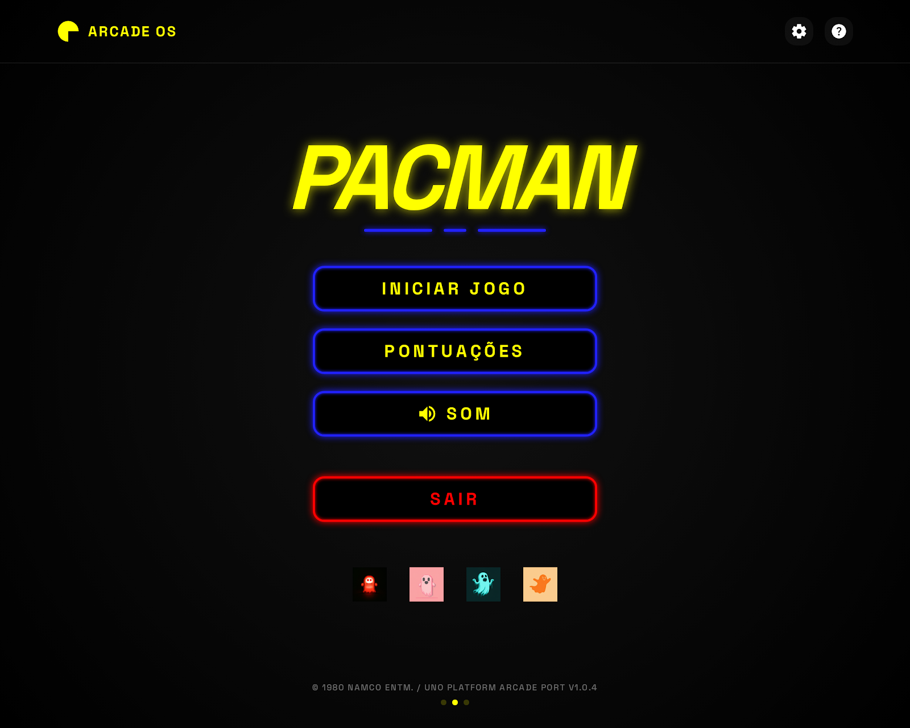
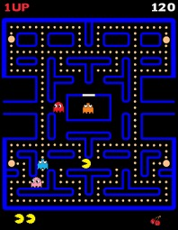
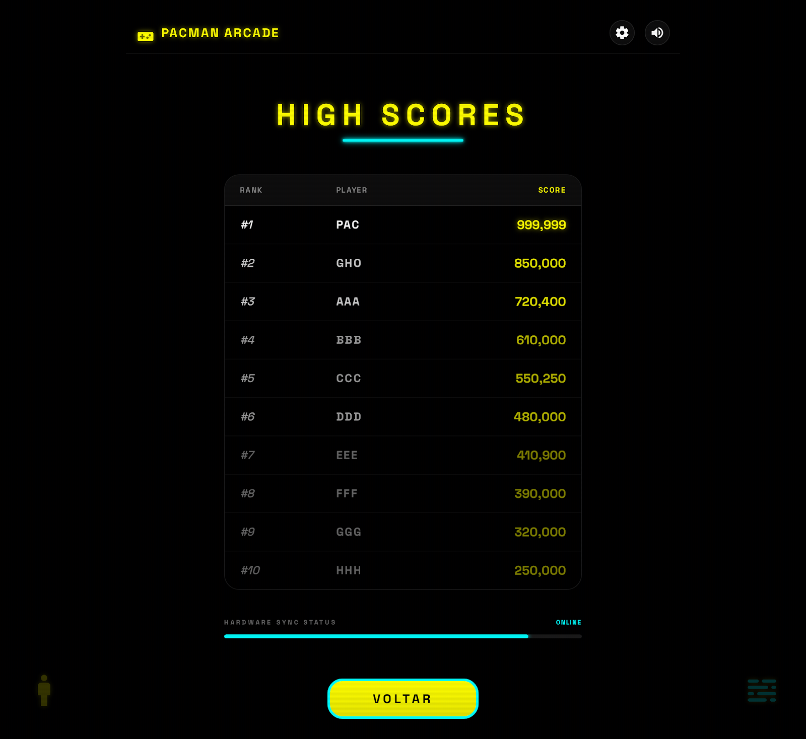
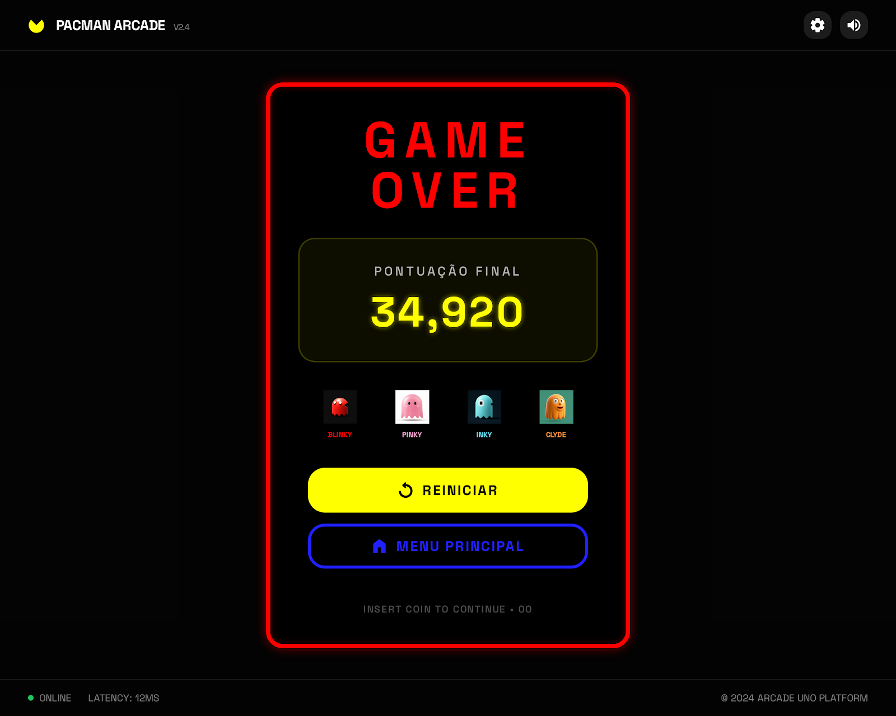

# Pacman Arcade - Templates do Projeto

Este documento reune os templates visuais planejados para cada tela do jogo Pacman. A ideia aqui e deixar registrado o que foi pensado antes de colocar a mão no codigo, servindo como referencia visual e funcional para a dupla durante o desenvolvimento.

O projeto e construido com **Uno Platform** e **C# (.NET 9)**, seguindo o padrao MVVM.

---

## 1. Menu Principal

> A porta de entrada do jogo. Tudo comeca aqui.



A tela de menu segue a estetica de um arcade clássico: fundo escuro, titulo grande em amarelo com efeito de glow e botões estilizados com bordas neon. A ideia e que o jogador sinta que esta diante de uma máquina de fliperama.

**O que o jogador encontra nessa tela:**

- **INICIAR JOGO** - Leva direto para o tabuleiro, é o caminho principal.
- **PONTUACOES** - Abre o ranking com as melhores pontuacoes. Os dados vem de uma tabela estática ou de um JSON pré-carregado(à definir).
- **SOM** - Liga e desliga a música/efeitos sonoros, é um toggle simples, sem salvar a preferência entre sessões.
- **SAIR** - Fecha o jogo. Esse botão tem borda vermelha para se destacar dos outros.

Na parte de baixo do menu, os quatro fantasmas clássicos (Blinky, Pinky, Inky e Clyde) aparecem como elementos decorativos, cada um no seu card colorido. O rodape traz o copyright e uns dots indicadores no estilo arcade.

**Arquivo planejado:** `PacmanMenuPage.xaml`

---

## 2. Tela do Jogo

> Onde a acao acontece. O labirinto, os pontos, os fantasmas.



Essa e a tela principal de gameplay. O tabuleiro ocupa a tela toda, com o HUD de pontuacao ("1 UP" e o score) posicionado no topo.

**O mapa:**
- Labirinto estático (desenhado, não gerado) com paredes azuis sobre fundo preto
- Pontos pequenos (dots) espalhados pelos corredores para o Pacman coletar
- 1 a 2 pontos grandes (power pellets) posicionados nos cantos do mapa
- A "casa dos fantasmas" fica no centro, com aquele retangulo classico e a portinha
- Cereja aparece como item decorativo (a logica de bônus será implementada futuramente)

**Como o Pacman se move:**
- Controlado pelas **setas do teclado**
- O movimento e continuo: basta pressionar uma direcao e o Pacman segue nela ate receber outro comando (nao precisa segurar a tecla)
- Colisao com paredes funciona normalmente, ele nao atravessa nada
- Cada ponto coletado reproduz um efeito sonoro (.wav ou .mp3 basico)

**Pontuacao:**
- Atualizada em tempo real no canto da tela
- Pontos pequenos valem menos, pontos grandes valem mais

**Arquivo planejado:** `GamePage.xaml`

---


## 3. Tela de Pontuacao (High Scores)

> O hall da fama, quem for bem pode ver seu nome aqui.



Essa tela mostra o ranking das melhores pontuacoes em formato de tabela, no estilo classico de arcade. O titulo "HIGH SCORES" em amarelo da o tom, e a tabela lista as 10 melhores colocacoes.

**Estrutura da tabela:**
- **RANK** - Posicao (#1 a #10)
- **PLAYER** - Nome com 3 letras, no estilo arcade (PAC, GHO, AAA...)
- **SCORE** - Pontuacao formatada com separador de milhares

Os dados sao estaticos ou carregados de um JSON pre-configurado. Na parte inferior, um botao "VOLTAR" em amarelo leva de volta ao menu principal. A tela ainda traz elementos decorativos como a barra de status "HARDWARE SYNC STATUS" e icones nos cantos, mantendo a estetica de terminal arcade.

**Arquivo planejado:** `HighScoresPage.xaml`

---

## 4. Game Over

> Acabou. Mas sempre da pra tentar de novo.



Quando o jogador perde as 3 vidas, essa tela aparece. O destaque e o card central com uma borda vermelha brilhante e efeito de glow, dando aquele peso visual de "fim de jogo".

**O que aparece na tela:**
- Titulo "GAME OVER" em vermelho, grande e centralizado
- A **pontuacao final** do jogador, exibida dentro de um sub-card com borda amarela
- Os 4 fantasmas em linha, cada um com seu nome embaixo (BLINKY, PINKY, INKY, CLYDE), como se estivessem "comemorando"
- Dois botoes de acao:
  - **REINICIAR** (amarelo) - Comeca uma nova partida do zero, com 3 vidas e score zerado
  - **MENU PRINCIPAL** (borda azul) - Volta para a tela inicial
- O texto "INSERT COIN TO CONTINUE" no rodape mantem a nostalgia arcade

**Arquivo planejado:** `GameOverPage.xaml` (ou modal sobre o `GamePage.xaml`)

---

## Fluxo entre as Telas

Para ter uma visao clara de como o jogador navega pelo jogo:

```
[Menu Principal] --"INICIAR JOGO"--> [Tela do Jogo]
[Menu Principal] --"PONTUACOES"----> [High Scores]
[Menu Principal] --"SAIR"----------> [Fechar Aplicacao]

[Tela do Jogo] --"Perdeu 3 vidas"--> [Game Over]

[Game Over] --"REINICIAR"----------> [Tela do Jogo]
[Game Over] --"MENU PRINCIPAL"-----> [Menu Principal]

[High Scores] --"VOLTAR"-----------> [Menu Principal]
```

---

## Resumo

| Tela              | Arquivo Planejado         | Funcao                                           |
|-------------------|---------------------------|--------------------------------------------------|
| Menu Principal    | `PacmanMenuPage.xaml`     | Navegacao inicial, som, sair                     |
| Tela do Jogo      | `GamePage.xaml`           | Gameplay: labirinto, pontos, vidas               |
| High Scores       | `HighScoresPage.xaml`     | Ranking das melhores pontuacoes                  |
| Game Over         | `GameOverPage.xaml`       | Fim de jogo, reiniciar ou voltar ao menu          |

